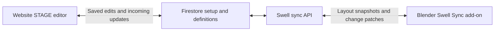

# Blender integration build plan

Living reference for the linked Swell 2D stage plot and Blender 3D stage editor.

## Current status

- Last updated: 2026-09-08.
- Phase: Actual keyboard setup and live cable routing complete locally; live-follow and saved-file validation passed.
- Current step: **Steps 0–5 complete; Step 6 cable routing built.**
- Next: refine estimated dimensions, connector positions and route controls with the band; optional future work is assembly-aware purchasing totals and pushing reviewed 3D route measurements into the website.
- Blockers: none for the core workflow. Existing unrelated rigid-body add-on reports errors on scene changes; Swell sync and scene saving work.
- Original setup: `QWSok55nO20JC3B8WL0x` (`playroom`).
- Website: http://localhost:3000/setups/QWSok55nO20JC3B8WL0x
- Blender file: `/Users/brianeichenberger/projects/the_swell/stage/playroom.blend`.

## Active performance setup — 2026-09-07

- Setup: `g8qTbUz0v4xk40HzhHoD`, **keyboard stage CENTER R**.
- File: `/Users/brianeichenberger/projects/the_swell/stage/keyboard_stage_center.blend`.
- Preserved the user's unsaved browser changes by saving revision 3 before import. Imported **28 nodes and 28 connection segments**, with the website's 46 × 24 ft stage and four routing waypoints (only used waypoints need curve controls).
- Revision 4 adds 14 provisional elevations for microphones, instruments, keyboard and console. XY footprints, graph connections and catalog dimensions remain unchanged.
- Procedural Telecaster, Fender-style bass and ES-335 models use recognizable silhouettes; they are planning approximations, not manufacturer CAD. Missing dimensions remain estimates in Blender. Existing physical dimensions take precedence.
- Five 1.8288 m reference people, a drum kit, keyboard support and console table are in a separate **Reference** collection, not added to website inventory.
- Wires use round beveled curves, 5–6 mm diameter initially. Diameter and color are estimates; the snake trunk in particular should be measured. Named jack empties follow gear transforms, and rounded floor routes update on the add-on timer without a website round trip.
- Cable curves lock their own transforms: move equipment, jack empties or route empties instead. Jack/waypoint refinements are local to the `.blend`; incoming changed website anchors/waypoints reset their corresponding local override. Curve Edit Mode edits will be regenerated.
- CSV export includes direct distance, modeled route, extra drop allowance, service slack, and required total. Assembly IDs identify snake/breakout segments; **28 segments are not 28 purchase quantities**. Website length fields are retained separately and still use the website's 2D algorithm.
- **Swell → Cable routing → Export cable measurements (CSV)** regenerates measurements after edits. The delivered CSV is a snapshot, not a continuously rewritten file.
- The 3D route estimates do not run obstacle avoidance or validate the electrical suitability of existing connections. The website/database remains authoritative for topology and metadata.

This document tracks the implementation strategy and progress. `PRD.md` remains the source of truth for the application data model and scope. Update both when implemented model changes require it.

Step 1 deliverable: [equipment sync contract and calibration](tools/blender/CONTRACT.md). Executable schemas live in `src/lib/setup-designer/blender-contract.ts`; conversion helpers live in `blender-coordinates.ts`. Verify them with `pnpm test:blender-contract`.

## Outcome

Arrange five six-foot-tall performers and the band's gear in Blender while maintaining corresponding placements in the website's 2D STAGE view. Gear definitions, inventory references, and signal connections remain in the website/database. Both editors can change placement. Blender can also correct dimensions stored on the website.

Start with explicit Pull and Push buttons. Add optional automatic synchronization after round trips and conflict handling are reliable. The integration must operate without an AI conversation running.

## Verified starting point

Inspected on 2026-09-07:

- Blender MCP connects to the open `playroom.blend`. Its sole scene object is the `stage` mesh, approximately 7.9248 × 3.6576 meters (26 × 12 feet), with zero thickness.
- The open website shows the matching stage outline, zero placed gear, and an Unsaved indicator. No browser save or scene edit was performed during planning. Recheck pending edits before implementation experiments.
- The active application uses Next.js, TypeScript, and Firestore.
- Setup nodes already have stable IDs, reusable definition references, dimension snapshots, and separate STAGE positions and SIGNAL positions.
- `StagePosition` stores feet-based X/Y, width/depth, clockwise rotation, and connection anchors. It does not store a complete 3D pose.
- Equipment physical dimensions support width, depth, and height in inches. Some dimensions are optional; the 2D renderer has category-based fallback footprints.
- Setup saves use a graph-wide revision check and Firestore transaction. The editor currently loads its workspace once and keeps unsaved recovery data locally; it does not subscribe to incoming setup changes.
- An existing add-on and API import stage bounds and a polygon outline from Blender. They do not implement equipment synchronization.
- Existing uncommitted application changes were present during planning. Preserve and inspect them before implementation; do not reset them.

Relevant implementation files:

- `tools/blender/swell_blender_sync/__init__.py`
- `src/app/api/setups/[setupId]/blender-sync/route.ts`
- `src/lib/setup-designer/domain.ts`
- `src/lib/setup-designer/serialization.ts`
- `src/lib/setup-designer/repository.ts`
- `src/lib/setup-designer/stage-plot.ts`
- `src/components/setup-designer/setup-workspace-client.tsx`
- `PRD.md`, especially Section 18

## Architecture and responsibilities

- **Blender MCP:** development, scene inspection, model creation, and debugging.
- **Computer-use:** visual and interaction verification in Blender and Chrome.
- **Swell Sync add-on:** persistent user-facing controls and deterministic synchronization.
- **Swell API:** authorized reads, validated field-level changes, revision checks, and transactional persistence. Extend or share logic with the existing bridge; preserve its stage-outline operation.
- **Firestore:** shared persisted setup, gear definitions, dimensions, and connections.
- **Website:** listen for committed updates, safely reconcile local edits, and show meaningful sync status.

Blender exchanges structured data with the API, not arbitrary executable code. Database administrator credentials stay server-side. Define setup-scoped authentication before enabling equipment writes; review the existing development-header/shared-token approach rather than assuming it is suitable for the expanded integration.

Manual synchronization uses request/response HTTP. Automatic mode can initially poll for changed revisions on the Blender side and use Firestore listeners in the browser. Choose a bounded, nonblocking transport implementation after checking the installed Blender version. Apply scene changes through Blender's main-thread mechanisms; avoid network waits during viewport interaction and background-thread access to Blender data.

## Data rules

### Identity and ownership

- Identify a placement by `(setupId, nodeId)`, not by object name or gear definition ID.
- Preserve definition ID/version and optional inventory asset ID separately.
- Five microphones of one model are five placements, even when their geometry is shared.
- Use a stable placement root in Blender with visual geometry underneath. Store identifiers as custom properties.
- Keep scene decorations, cameras, lights, and unsynchronized models outside the managed item collection.
- Pulls update existing items in place and create only missing placements. Renaming an object must not break the link.
- Website additions/removals drive membership initially. A locally deleted or duplicated Blender object must be flagged for reconciliation, not silently delete or duplicate database gear.
- Respect assemblies: logical signal endpoints may represent one physical assembly. Map these deliberately rather than producing a full device for every logical node.

### Coordinates and pose

- Use meters in the bridge contract, feet for the existing website placements, and inches for catalog dimensions. Use exact conversion factors: 1 foot = 0.3048 meters; 1 inch = 0.0254 meters.
- Define a stage reference transform, audience edge, origin, axis directions, and ground elevation. Persist the calibration so reopening Blender does not change alignment.
- Convert the website's unrotated footprint origin to the Blender placement center explicitly; account for reversed vertical direction and clockwise versus counterclockwise rotation.
- Respect Blender scene unit scale and object/parent transforms.
- Preserve horizontal position, facing, elevation, pitch, and roll across round trips. Moving an item in 2D must preserve its 3D-only pose fields.
- Do not quantize precise Blender positions to the website's quarter-foot drag grid during import or serialization. Grid snapping should apply only to deliberate editor operations.
- Changing dimensions should preserve the item's agreed placement anchor, normally the floor-footprint center.
- Document behavior outside the stage perimeter; prevent existing rectangular clamping from silently changing imported positions.

### Dimensions: bidirectional and explicitly scoped

**Required:** Blender can push width, depth, and height corrections back to the website, not just position.

Keep three concepts distinct:

1. **Catalog dimensions:** the physical product measurements on the reusable gear definition.
2. **Setup dimensions:** measured or overridden dimensions for this placement, including its dimension snapshot.
3. **Operating footprint and configuration:** floor space in the current pose, stand height, boom reach, clearance, or attachment configuration.

A tilted microphone or held guitar must not rewrite catalog dimensions merely because its world-aligned bounding box changed. Measure canonical dimensions in the item's defined local axes, accounting for scale. Use designated geometry or explicit dimension controls; exclude labels, clearance guides, and attached independent gear from catalog measurements.

Provide two dimension-write scopes:

- **This placement:** update the placement's physical dimension override/snapshot and relevant 2D footprint. Leave the reusable definition unchanged.
- **Correct gear definition:** present old and proposed width/depth/height, units, target definition, and affected scope. On an explicit user action, update the reusable definition and current placement together where practical, increment its version, and record provenance. Future placements use the correction.

Do not silently rewrite every existing placement of that definition. Offer deliberate propagation later, with a preview of affected placements and protection for their overrides. Surface stale snapshots rather than applying inconsistent measurements unnoticed.

Additional rules:

- Show dimension differences in the push preview, alongside position changes.
- Rotation alone must never be interpreted as a dimension correction.
- Permit geometry edits or numeric dimensions as correction inputs; detect unapplied and nonuniform scale consistently.
- If shared mesh data would resize multiple placements, make the geometry independent or explicitly identify the affected set.
- Reject nonfinite or invalid dimensions. Flag missing measurements and label fallback proxies as estimates.
- Preserve product-dimension provenance where useful: prior value, new value, source (`Blender`), timestamp, and actor. Do not treat a modeled estimate as a verified real-world measurement.
- Physical corrections must not accidentally overwrite operating clearance or stand configuration.

### Connections and attachments

- Keep logical ports, inventory assignments, cable topology, and SIGNAL positions intact during spatial writes.
- Recompute derived 2D cable lengths after placement, footprint, or anchor changes using shared application logic.
- Add attachment relationships for independently identified items, such as a microphone mounted on a stand. Store a parent placement ID and local attachment transform; moving the parent updates the child's effective placement.
- Cable visualization is implemented with provisional 3D jack controls. Current 2D anchors and drop allowances do not establish precise physical jack positions; refine them in Blender.

## Sync behavior and conflict policy

Initial Blender controls:

- Connect to setup / open website.
- Pull from website.
- Preview and push changes, including dimension scope.
- Pending changes, last successful revision, conflict, and connection status.

Initial workflow: save website edits → pull into Blender → edit placement or dimensions → review push changes → commit → open website receives updates without a reload.

- Use versioned snapshots for reads and field-level patches for writes. Never replace the full setup graph with a Blender scene export.
- Require a base revision. Initially reject stale writes safely using the existing graph-wide revision; retain the local changes and offer refresh/review/retry. Field-level merging can follow with a retained base snapshot.
- If both editors modify the same field, present both values. Do not use silent last-writer-wins.
- When the browser is dirty, retain its draft and surface the incoming change; do not replace local state or tell the user to reload away their work.
- Include mutation IDs/origin tracking and acknowledgements to make retries safe and prevent echo loops.
- A pull must not discard pending Blender edits without an explicit resolution action.
- Handle removals explicitly and preserve a recoverable local copy when an incoming removal conflicts with local edits.
- Reopening a `.blend`, undoing a move, reconnecting, and switching setups must reconcile against the server revision before pushing. Old saved scenes must not silently overwrite newer layouts.
- Automatic mode is opt-in and starts only after manual synchronization passes. Commit after completed edits, not every mouse movement. Catalog corrections remain explicit actions even when placement auto-sync is enabled.

## Implementation checklist

Only mark a step complete when its acceptance criteria are demonstrated. Record evidence in the work log.

### 0 — Inspect and establish the plan [complete]

- [x] Confirm Blender MCP connection and matching stage dimensions.
- [x] Inspect website placement model, save behavior, and existing stage bridge.
- [x] Agree on add-on/API architecture and manual-first delivery.
- [x] Include Blender-to-website dimension correction as a core requirement.

### 1 — Define the contract and calibration [complete]

- [x] Inspect installed add-on/version and current worktree before changing code.
- [x] Define snapshot/patch schemas, authentication, revision and mutation fields.
- [x] Specify 3D pose, placement dimension overrides, correction scope, and provenance.
- [x] Define identity mapping for gear, performers, and physical assemblies.
- [x] Calibrate stage origin/axes and canonical model measurement conventions.
- [x] Update `PRD.md` alongside implemented schema changes and preserve backward compatibility in serialization.

Acceptance: explicit examples map an asymmetric item at known positions/rotations between both editors, including a dimension correction with unchanged placement center. Existing saved setups still load correctly.

Evidence: 11 automated tests passed, covering golden coordinates, arbitrary heading/tilt/elevation, scene units, center-preserving resize, strict correction scopes, legacy graph serialization, and preservation of 3D state through 2D saves. Blender math-only checks confirmed the golden examples at 0°, 90°, and 37°; scene still contained its original single object and remained clean. TypeScript, lint, and production build passed. The calibration is documented and tested, not yet written into the `.blend` by an equipment add-on.

### 2 — Prove one complete manual round trip [complete]

- [x] Implement setup-scoped pairing/authentication and transactional receipts from `tools/blender/CONTRACT.md`.
- [x] Remove import-time clamping/minimum-size substitution for explicit physical placements while retaining deliberate browser interaction constraints.
- [x] Make all reusable-definition writes version-aware before enabling catalog corrections.
- [x] Verify canonical geometry measurement under evaluated modifiers, object/parent scale, and pose; reject ambiguous shear/reflections.
- [x] Use a dedicated test setup or duplicate for experiments; preserve the user's live draft and stage.
- [x] Read one saved item through the API and create a dimensioned Blender proxy.
- [x] Move and rotate it, then push only the changed placement fields.
- [x] Resize it and push corrected width/depth/height for this placement.
- [x] Correct its reusable definition through the explicit dimension-correction action.
- [x] Add safe browser reception of committed updates.
- [x] Implement stale-revision, pending-draft, failed-request, and retry behavior.

Acceptance: website → Blender → website preserves identity and units; corrections appear in both views and persist after reopening. A new instance uses corrected catalog dimensions; unrelated existing instances retain their snapshots. Rotation alone produces no dimension patch. Signal connections remain unchanged.

### 3 — Synchronize the full setup reliably [complete]

- [x] Incremental creation/update/removal with stable placement roots.
- [x] Repeated pulls, duplicate names, five identical items, and physical assemblies.
- [x] Missing dimension indicators and per-item correction review.
- [x] Preserve visual customization during data-only pulls.
- [x] Handle local deletion/duplication, reconnect, undo, and old `.blend` revisions.
- [x] Recompute relevant derived cable measurements without changing topology.

Acceptance: repeated syncs do not duplicate items or destroy unrelated scene objects; stale data never silently overwrites a newer setup.

### 4 — Build a useful band scene [complete]

- [x] Five recognizable 1.8288-meter-tall performer proxies with STAGE-only placements.
- [x] Simple models for boxes, pedals, amps, microphones, mic stands, guitar stands, and drums.
- [x] Placement elevation, orientation, stand configuration, and attachments.
- [x] Distinguish product dimensions from pose-dependent footprints.
- [x] Establish comfortable orbit/walkthrough views and clear selection labels.

Acceptance: the band and gear can be arranged at credible scale; moving a stand moves its attached microphone, and both retain individual identities. Better visual models can replace proxies without breaking sync.

### 5 — Add optional automatic synchronization [complete]

- [x] Commit website changes after completed edits while retaining draft safety.
- [x] Detect completed Blender changes and debounce outgoing patches.
- [x] Nonblocking revision checks, backoff, pause/resume, and connection status.
- [x] Avoid echo loops and edits arriving during an active manipulation.
- [x] Keep catalog corrections explicitly reviewed.

Acceptance: completed edits appear on the other side within a short delay (one-second debounce plus up to three-second polling, excluding network latency), without UI freezes, excessive writes, or silent conflict resolution.

### 6 — Optional enhancements

- [ ] Preview and propagate catalog corrections to selected existing placements.
- [x] 3D port positions and cable visualization with explicit routing assumptions; validated on keyboard stage CENTER R.
- [ ] Better visual assets, collision/clearance aids, and saved camera views.
- [ ] Consider a website 3D viewer only if requested; it is not needed for this integration.

## Verification and completion

Use focused automated tests for conversion, measurement, serialization, patches, and conflict handling. Verify actual interactions in the open applications as well.

Required scenarios include:

- Non-square gear at 0°, 90°, and an arbitrary angle; elevation and tilt preserved.
- Applied/unapplied scale, parent transforms, and rotated geometry produce correct dimensions.
- Dimension correction updates the intended scope only and survives save/reopen.
- Two same-definition items keep distinct identities and independent overrides.
- Browser unsaved edits versus an incoming Blender update; simultaneous changes; retries after lost acknowledgement.
- Existing SIGNAL layout, ports, connections, and inventory references remain intact.
- Repeated pulls, undo, reconnect, missing/deleted items, and an older `.blend`.
- Existing stage-outline import still works.

For implementation changes, run the repository-required checks: `pnpm exec tsc --noEmit`, `pnpm lint`, and `pnpm build`. Documentation-only updates do not require application builds.

## Maintaining this plan

At each meaningful work session:

1. Read Current status and the active step before starting.
2. Update checkboxes only for demonstrated work; record tests or artifacts in the work log.
3. Update Current step, Next deliverable, and Blockers before handing off.
4. When strategy changes, update the affected sections and record the decision and reason below. Clearly distinguish proposals from implemented behavior.
5. Update `PRD.md` when implemented schema or product behavior changes. This plan must not become a competing data-model specification.

## Decision log

| Date | Decision | Reason |
| --- | --- | --- |
| 2026-09-07 | Use MCP and computer-use for development; add-on/API for ongoing sync. | Sync must work independently of an AI session. |
| 2026-09-07 | Deliver manual synchronization before auto-sync. | Establish correct identity, measurement, and conflict behavior first. |
| 2026-09-07 | Include bidirectional dimensions in the first round trip. | Some website dimensions may be incorrect; Blender must support correction. |
| 2026-09-07 | Separate placement corrections from reusable-definition corrections. | Correct gear data without unintentionally resizing every existing setup or confusing product size with pose. |
| 2026-09-07 | Keep optional elevation/tilt/footprint mode under node data as `stage3d`; retain graph schema v2. | Existing serializers can preserve 3D state without a database backfill or conflating physical dimensions with operating footprint. |
| 2026-09-07 | Use a separate equipment endpoint and setup-scoped pairing session; isolate network work in a worker process. | Preserve the current outline importer and define a bounded connection that does not block Blender's viewport. Implementation belongs to Step 2. |
| 2026-09-07 | Require version-aware definition edits across the website before catalog corrections. | Existing stale browser saves could otherwise overwrite a successful Blender correction. |
| 2026-09-07 | Keep the existing template snapshot version when correcting dimensions only; record dimension version separately in audit history. | A size-only correction does not refresh ports, images, or all other snapshot fields. |

## Work log

| Date | Work completed | Verification / next action |
| --- | --- | --- |
| 2026-09-07 | Inspected scene, website, source model, and existing stage bridge; created this plan. | Matching 26 × 12 ft stage confirmed. No integration implementation or scene/database edits performed. Next: Step 1. |
| 2026-09-07 | Completed Step 1: documented API/auth/conflict strategy, verified trapezoid calibration and installed add-on, added executable wire schemas/conversions, optional 3D-state persistence, tests, and PRD update. | 11 contract tests, Blender math checks, `pnpm exec tsc --noEmit`, `pnpm lint`, `pnpm build`, and `git diff --check` passed. Live database and scene unchanged. Next: Step 2 prerequisites, then one-item round trip. |

| 2026-09-07 | Built scoped sessions, transactional spatial API and receipts, version-aware definition writes, browser three-way merge and autosave, nonblocking Blender worker, explicit dimension previews, attachments and procedural models. Created isolated test setup and 28 provisional playroom placements without changing existing catalog definitions. | Manual and automatic round trips passed; definition correction, idempotent retry, stale revisions, same-field browser conflict UI, five duplicate-name items, parent movement/scale independence, and canonical measurement checks verified. Final lifecycle checks and documentation in progress. |

| 2026-09-07 | Completed Steps 3–5: 28 stable linked placements, five 1.8288 m performers, five attached microphones, procedural gear, explicit dimension-source/scope preview, nonblocking automatic mode, saved scene/preview, add-on archive and operating guide. Archived the isolated test setup/definition and revoked its connections after verification. | 21 contract/merge/attachment tests; live manual and automatic round trips; same-field browser conflict selection; retry/auth checks; seven evaluated-geometry checks; Blender local-deletion/duplicate/remote-removal/undo/old-revision/offline checks; fresh background load confirmed 28 identities, all five exact-height performers, attachments and calibration. TypeScript, lint and production build passed; final packaging reviewed. |

## Delivered files and current session

- Working scene: `/Users/brianeichenberger/projects/the_swell/stage/playroom.blend`.
- Original backup: `/Users/brianeichenberger/projects/the_swell/stage/playroom.before-swell-sync-20260907.blend`.
- User guide: [tools/blender/README.md](tools/blender/README.md).
- Preview: [output/blender/playroom-preview.png](output/blender/playroom-preview.png).
- Installable add-on: [output/blender/swell_blender_sync.zip](output/blender/swell_blender_sync.zip).
- The current playroom session has automatic saving/sync enabled in both editors. Reconnect after reopening Blender or after the eight-hour session expiry; re-enable automatic mode after reconnect/reload.
- Code is local and uncommitted; no production deployment was performed. The local app uses the existing Firestore project, so the playroom placements are saved there.

## Deliberate limits of this delivery

- The 28-item layout is provisional. Five people are anonymous planning mannequins, with no invented band-member or inventory assignments. The existing gear library supplies real definitions where available. Missing sizes and generic amps/drums are explicit placement-only estimates; existing catalog dimensions were not changed to seed playroom.
- Add-on calibration currently uses a horizontal axis-aligned stage. Yaw-aware conversion helpers are tested, but arbitrary reference-frame rotation is not exposed by the add-on.
- Use the root measurement cage or Outliner root for transforms and size edits. Decorative child geometry can be customized without changing measured dimensions; a replacement measurement mesh must preserve the bottom-center convention.
- Endpoint/cable proxies retain individual identities, omit inherited whole-product dimensions until explicitly corrected, and cannot correct whole-assembly definitions. 3D cable routes are now implemented (see active performance setup); detailed manufacturer-specific endpoint geometry remains optional.
- No collision/clearance solving or automatic catalog-size propagation. Physical footprint means canonical-box projection, not an exact mesh silhouette.
- Integration tests used real scoped sessions issued through the server helper. Browser connection controls were inspected; the entire user-click pairing flow remains a routine sign-in/clipboard step for reconnection. Independent background loading verified persisted scene data without disrupting the open Blender session.

Final visual verification: constrained the desktop workspace height so the gear library scrolls independently and Fit displays the complete stage. Restarted the stale development CSS watcher and verified the actual canvas height (1078 px in a 1334 px viewport), all 28 stage placements, and automatic website saving. TypeScript, lint, production build, source/install/zip equality, and diff whitespace checks passed.

### Keyboard setup verification completed

- Live add-on timer followed a translated, rotated and scaled Telecaster; routed length changed from 6.931 ft to 6.013 ft and restored exactly, with no test changes sent to the website.
- Independent saved-file reopen validated all 28 node IDs, 28 cable IDs, endpoint positions, diameter bounds, length accounting and local waypoint persistence.
- 22 contract tests passed; TypeScript, lint and production build passed.
- Current browser is saved at revision 4; website autosave and Blender Auto Sync are enabled. Connection expiry/reopening still requires reconnecting for network sync.
- Delivered preview `keyboard_stage_center.png`, CSV `keyboard_stage_center.cables.csv`, and in-file READ ME.

### Photo-based instrument refinement — 2026-09-08

- Replaced only the three linked instruments' visual children using the user's `telecaster .jpeg`, `mustang bass .jpeg`, and `335 .jpeg` references.
- Added hand-traced body, headstock and pickguard contours, tapered necks, fret markers, individual strings/tuners and distinctive hardware. Mustang uses faded blue, pearl-colored guard and split pickups; ES-335 uses procedural sunburst, cream binding, twin humbuckers and f-holes; Tele uses blonde finish, black guard and angled bridge pickup.
- Geometry remains deliberately low-poly. The supplied photos are references, not applied flat photo textures. Existing placement dimensions remain provisional where previously estimated; photos do not establish a new physical measurement.
- Preserved roots, transforms, measurements, cable endpoint children, and pre-existing local sync state. Saved the original scene state to `keyboard_stage_center.before-photo-instruments.blend` before replacing visual geometry.
- Reusable builder: `tools/blender/swell_blender_sync/instruments.py`. Close-up preview: `/Users/brianeichenberger/projects/the_swell/stage/instruments_photo_reference.png`.

- Photo-refinement verification: independent saved-file reload passed with 28 linked nodes, 28 cable curves, correct endpoint bindings and zero spatial changes. TypeScript, lint and production build passed; close-up and stage previews rendered and inspected.

### Shared waypoint position sync — 2026-09-08

- Added all-waypoint snapshots (including unused points) and revision-checked XY waypoint patches through the existing setup-scoped API. Cable membership/order remains website-owned.
- Installed labeled, plane-locked waypoint markers and included their position changes in manual/automatic push, acknowledgements, conflict detection, independent-axis merge, and explicit conflict resolution. Existing local jack refinements remain local.
- Verified a 0.1 ft Blender move of a shared waypoint updated the website and both referencing cable routes; restored its original position from the website and verified Blender followed. All four markers labeled, source/install/package matching, scene saved at revision 21.
- Verification: 24 contract tests, live independent-axis/same-axis/deletion conflict checks, TypeScript, ESLint, production build and Python syntax passed. No cable membership changes were made.

### Microphone cable stand routing — 2026-09-08

- Microphone cable descents now derive their path from the linked stand's boom and upright end-cap centers, with clearance beside the rods and a floor entry beside the base. Other equipment retains direct descent. Shared floor waypoints and graph connections are unchanged.
- Installed and visually inspected the live routing; all nine stand-mounted microphones use the guided path. A reversible stand rotation confirmed guide points follow automatically. Current scene and add-on archive updated.
